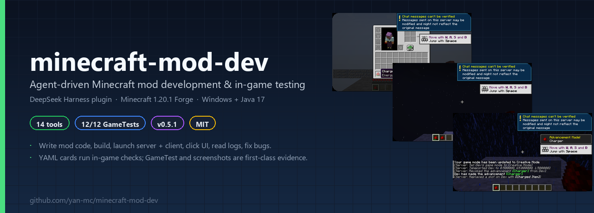
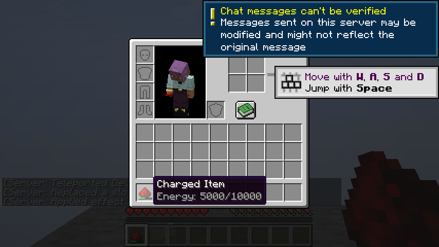
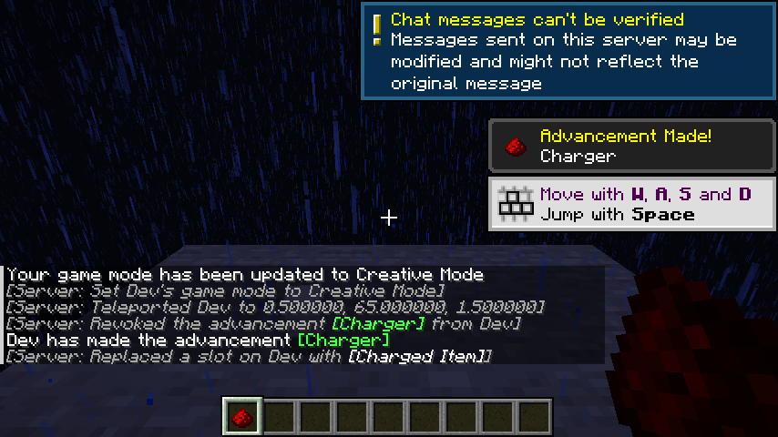
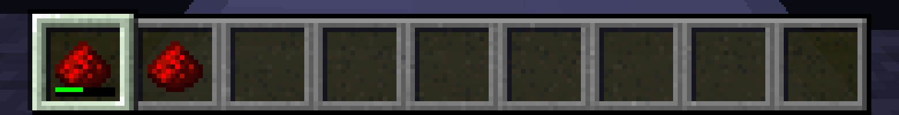
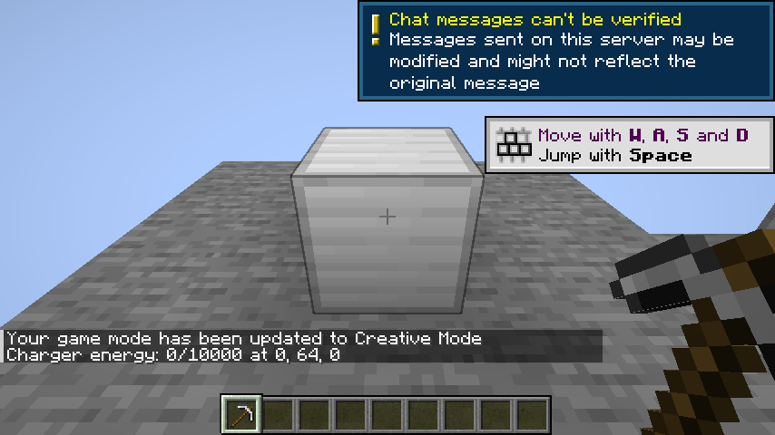

# minecraft-mod-dev



**让 AI 团队真正“玩到”自己写的 Minecraft 模组。**  
DeepSeek Harness 插件 + Minecraft 1.20.1 Forge 探针：写代码、构建、启动真实服务端/客户端、点 UI、截图、读日志、跑 GameTest、修 bug，全在一个工具层里完成。

[](https://github.com/yan-mc/minecraft-mod-dev/releases)
[](LICENSE)
[](docs/INSTALL.md)
[](docs/INSTALL.md)
[](docs/INSTALL.md)
[](lab/forge-1.20.1-test/REPORT.md)

> 研究/原型项目，不是生产级产品。当前只支持 **Windows 10/11 x64 + Minecraft 1.20.1 + Forge 47.4.x + Java 17 + DSH 0.2.1-rc.2**。

---

## 它解决什么问题

传统上，AI 写 MC 模组只能停在“代码看起来对”。改一个 GUI、一个物品条、一个配方掉落，都要人手动进游戏点一遍、看日志、截图、修。

这个项目把“AI 能自己看到游戏里发生了什么”做成可调用的工具：

- **服务端探针**：状态、命令、方块/NBT、配方、掉落、物品、世界破坏、日志、run dump；
- **客户端探针**：UI 控件树、槽位、鼠标点击、右键、截图、聊天命令；
- **启动器**：`mcdev_prepare` 启动真实 `runServer` / `runClient`，等进服，失败自动重试；
- **卡片执行器**：YAML 卡片 → 可重复的 in-game 检查（含断言、截图、干跑）；
- **团队模式**：Builder / Tester / Reviewer 在 Agent Teams 里分工，Lead 收口。

## 核心能力

| 能力 | 说明 |
|---|---|
| 🧱 构建 | `mcdev_build`：Gradle 构建，返回 exitCode/tail |
| 🧪 自动化测试 | `mcdev_gametest`：Forge GameTestServer，当前参考模组 **12/12** |
| 🚀 启动真实游戏 | `mcdev_prepare`：server / client / both；TitleScreen 后显式 `/connect`，不用 quickPlay |
| 🖥️ 客户端观察 | `mcdev_ui`、`mcdev_click`、`mcdev_use`、`mcdev_screenshot` |
| 📊 服务端检查 | `mcdev_status`、`mcdev_command`、`mcdev_run_dump` |
| 🃏 卡片执行 | `mcdev_scenario`：YAML 卡片、`dryRun`、步骤/断言、`warnings` 不静默通过 |
| 🧩 游戏内语义 | 方块/NBT、comparator analog、recipe、loot、craft、item bar、生存挖掘 |
| 🤝 团队协作 | `mcmod` preset + Agent Teams；任务板、Tester/Reviewer 复核 |
| 🧯 稳定性 | devJar 校验、独立 run 目录、Disconnected 提前判失败、最多 3 次重试 |

## 快速开始

### 1. 安装 release

从 [Releases](https://github.com/yan-mc/minecraft-mod-dev/releases) 下载：

- `minecraft-mod-dev-0.5.1.zip`（插件）
- `mcdev_probe-0.1.0-dev.jar`（dev-mapped 探针）

在 DSH 中安装插件：

```text
plugin_manager install_bundle target=<解压目录>/minecraft-mod-dev
```

### 2. 构建/安装探针

从源码：

```powershell
cd lab\mcdev-probe
.\gradlew.bat clean devJar
```

把 `lab\mcdev-probe\build\libs\mcdev_probe-0.1.0-dev.jar` 放进：

```text
lab\forge-1.20.1-test\run-server\mods\
lab\forge-1.20.1-test\run-client\mods\
```

或用工具校验并复制：

```text
mcdev_install_probe
  probeJar=F:\...\lab\mcdev-probe\build\libs\mcdev_probe-0.1.0-dev.jar
  runDirs=["F:\...\lab\forge-1.20.1-test\run-server",
           "F:\...\lab\forge-1.20.1-test\run-client"]
```

> 必须使用 `*-dev.jar`；普通 reobf jar 在 dev 环境会 `NoSuchMethodError`。

### 3. 启动

```text
mcdev_prepare
  projectDir=F:\...\lab\forge-1.20.1-test
  kind=both
```

客户端不依赖 quickPlay：到 TitleScreen 后由插件调用 `/connect` 显式连接。期望：

```json
{"ok":true,"results":[
  {"kind":"server","port":39001,"ready":true},
  {"kind":"client","port":39002,"ready":true,"joined":true}
]}
```

### 4. 跑一张卡片

```text
mcdev_scenario card=F:\...\lab\forge-1.20.1-test\cards\F-002.yml
```

期望：

```json
{"ok":true,"warnings":[],"steps":[...]}
```

### 5. 收尾

```text
mcdev_stop side=all
```

## 卡片执行

卡片是 YAML，可直接给 AI 或人复用：

```yaml
id: F-002
setup:
  commands:
    - "setblock 0 64 0 examplemod:charger"
    - "tp Dev 0.5 64 1.5 180 0"
actions:
  - {wait: 300}
  - {use_on: {x: 0, y: 64, z: 0, face: up}}
  - {wait: 300}
assert:
  - {screen_title: "Charger"}
  - {slot_exists: 0}
```

`mcdev_scenario` 支持：

- `dryRun`：只翻译/报告，不执行；
- `wait`、`command`、`use`、`ui`、`click`、`screenshot`、`run_dump`；
- `block` / `break` / `mine` / `client_mine` / `items` / `recipe` / `loot` / `item` / `craft`；
- `assert.comparator` / `recipe_output` / `loot_drop` / `loot_break` / `loot_mine` / `block_state` / `loot_items` / `item_bar` / `craft`。

未支持的字段进入 `warnings`，**不会静默当作通过**。  
完整卡片语法见 [docs/TOOLS.md](docs/TOOLS.md)。

## 参考模组：Charger

`lab/forge-1.20.1-test` 是完整可玩的参考模组：

- 充能方块 + 能量 NBT + comparator；
- 充能物品 + tooltip + 热栏能量条；
- GUI（37 槽、shift-click、关闭重开）；
- 配方、loot、`/charger info`、advancement、生存挖掘。

7 张功能卡（F-001..F-007）+ 12 个 GameTest + 5 类注入 bug 演练，全部有可复现证据。

| 卡片 | 覆盖 |
|---|---|
| F-001 | 方块右键充能、NBT、comparator |
| F-002 | GUI 打开/槽位/shift-click |
| F-003 | 物品 tooltip |
| F-004 | recipe / loot / craft |
| F-005 | 命令 raycast / advancement |
| F-006 | item bar visible/width/color |
| F-007 | 生存挖掘 + 掉落 |

## 截图

| Tooltip | Advancement toast |
|---|---|
|  |  |

| Hotbar energy bar | Raycast command |
|---|---|
|  |  |

## 架构

```text
┌──────────────────────────────┐
│ DeepSeek Harness / Agent Team │
│  Lead · Builder · Tester ...  │
└──────────────┬───────────────┘
               │ mcdev_* tools
┌──────────────▼───────────────┐
│ plugin/minecraft-mod-dev      │
│  14 tools · mcmod preset      │
│  Agent Teams mount            │
└──────────────┬───────────────┘
               │ HTTP 127.0.0.1:39001/39002
┌──────────────▼───────────────┐     ┌────────────────────┐
│ lab/mcdev-probe (Forge mod)   │────▶│ Minecraft server    │
│  server probe + client probe  │     │ Minecraft client    │
│  Mixin tick · GameTest        │     │ (real GUI/world)    │
└──────────────────────────────┘     └────────────────────┘
```

- 服务端 probe：39001；客户端 probe：39002；测试服：25566；
- 独立 `run-server/`、`run-client/`、`run-gametest/`，避免登录超时；
- dev-only Mixin：`remap=false` + `tick` 字面量，生产 SRG 未支持。

## 仓库结构

```text
plugin/minecraft-mod-dev/     DSH 插件：14 个工具 + mcmod preset + 团队挂载
lab/mcdev-probe/              服务端/客户端探针 Forge mod
lab/forge-1.20.1-test/        Charger 参考模组、7 张卡、12 个 GameTest
docs/                         安装、手册、工具、团队、排障、演示、发布
docs/assets/                  README banner 与截图
```

## 文档

- 📖 **[完整说明书 MANUAL.md](docs/MANUAL.md)** — 架构、安装、工具、卡片、团队、测试、排障、二次开发
- 🚀 [安装与快速开始](docs/INSTALL.md)
- 🧰 [工具与卡片语法](docs/TOOLS.md)
- 🤝 [团队模式](docs/TEAM.md)
- 🩺 [常见问题与排障](docs/TROUBLESHOOTING.md)
- 📊 [当前状态](docs/STATUS.md)
- 🎬 [10 分钟演示](docs/DEMO.md)
- 📦 [发布说明](docs/RELEASE.md)
- 📝 [Changelog](CHANGELOG.md)

## 状态

| 项 | 结果 |
|---|---|
| 插件版本 | `0.5.1` |
| GameTest | **12/12** |
| 功能卡 | F-001..F-007 全部 live，`warnings=[]` |
| 注入 bug | 5/5 检出并修复 |
| Release | [v0.5.1](https://github.com/yan-mc/minecraft-mod-dev/releases/tag/v0.5.1)（beta） |
| 测试环境 | Windows 11 + Temurin 17.0.19 + Forge 47.4.28 |

## 已知限制

- 只支持 **MC 1.20.1 + Forge 47.4.x + Java 17 + Windows**；
- 探针 Mixin 是 **dev-only**，生产 SRG 未支持；
- Agent Teams 是 DSH 实验特性，成员/任务状态可能不同步；
- 客户端本地方块状态可能短暂滞后，**以服务端 `/world/block` 为准**；
- 不做 WASD 实时操作，不替代主观验收；
- `craft` 是服务端合成模拟，不走 GUI；
- 正式 npm 发布未做；目前本地 link 安装 + GitHub release 资产。

## License

原创代码与文档：MIT，见 [LICENSE](LICENSE)。  
Minecraft / Forge / Gradle / Mixin 等第三方组件保留各自许可证，见 [THIRD_PARTY_NOTICES.md](THIRD_PARTY_NOTICES.md)。本仓库不重新分发 Minecraft 客户端或资源。
